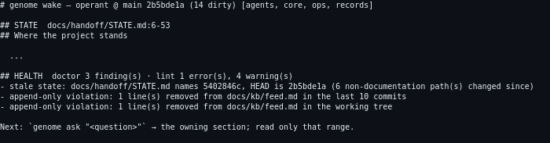

# project-genome

Project knowledge fails in a few predictable ways: two documents answer one question and drift apart; a document has no declared mutability, so state rots and frozen evidence gets edited; nothing routes a question to its owner, so every agent reads everything. Research projects add a worse one — a number in a doc stops matching the artefact that produced it, and the stale figure keeps getting quoted.

project-genome prevents this with **documentation roles that have owners and mutability classes**, and a stdlib CLI that checks them. One call orients a fresh agent (`wake`), one finds the answer (`ask`), one closes the session (`close`).

```console
$ genome wake
# genome wake — operant @ main 2b5bde1a (14 dirty) [agents, core, ops, records]

## STATE  docs/handoff/STATE.md:6-53
## Where the project stands
  ...

## HEALTH  doctor 3 finding(s) · lint 1 error(s), 4 warning(s)
- stale state: docs/handoff/STATE.md names 5402846c, HEAD is 2b5bde1a (6 non-documentation path(s) changed since)
- append-only violation: 1 line(s) removed from docs/kb/feed.md in the last 10 commits

Next: `genome ask "<question>"` → the owning section; read only that range.
```



- **One file, zero dependencies.** The CLI is stdlib only, Python ≥ 3.11. Nothing to resolve, nothing to compile.
- **Self-checking.** `scripts/test_genome.py` runs 38 independent cases against a scratch copy; it never writes your project.
- **Scales by module.** A small app needs `core`. A multi-year R&D program turns on records, research evidence, ops gates, and multi-agent boards — same CLI.
- **Federates.** Per-project genomes exchange typed cards (`federate`), so a portfolio of repos answers questions as one (`ask --all`).

## Install

```bash
curl -fsSL https://raw.githubusercontent.com/ishan-parihar/project-genome/main/install.sh | bash
```

On Windows: `irm https://raw.githubusercontent.com/ishan-parihar/project-genome/main/install.ps1 | iex`.

The installer is one line and it decides the rest: it tries `uv`, then `pipx`, then `pip` — and where every PyPI rung refuses (the package is not published yet, or you are installing an unreleased build), it installs from the Git repository instead, if this machine has git. Nothing is installed into a **system** Python: where `pip --user` is refused outright (the PEP 668 [externally-managed environments](https://peps.python.org/pep-0668/) that Debian, Ubuntu and Mint mark on their system Pythons — `/usr/lib/python3.14/EXTERNALLY-MANAGED`), the last rung falls back to an isolated venv at `$XDG_DATA_HOME/project-genome/tool`, which also makes re-running the installer always pick up the current build.

Once it is on PyPI, the plain package managers work and need no script or git:

```bash
uv tool install project-genome        # recommended: self-contained, no venv
pipx install project-genome           # or: pip install --user project-genome
```

To update later, re-run the installer — it is idempotent, so a second run updates the copy it put there without duplicating PATH lines or config. A repo that **vendors** `scripts/genome` updates that copy with `genome installs upgrade --apply` instead, because the CLI must never overwrite a repo's own vendored file.

Flags the installer takes: `--skill` (also install the agent-skill bundle), `--dir <path>` (an extra skills root, repeatable), `--from-github` (force the Git path even after publication), `--no-cta`, `--force-root`.

**As an agent skill** — the methodology, the CLI, and the references, installed into the harnesses you have:

```bash
npx skills add ishan-parihar/project-genome --agent '*' --skill '*' -y
```

The CLI and the skill are separate deliverables. The package installs the tool; the skill teaches an agent how to drive it.

### What it touches

| Concern | Answer |
|---|---|
| Files written | Inside your project only: `genome.toml` and the directories your module set declares. Two exceptions, both under `$HOME`: the install registry (`~/.config/genome/installs.json`) and the federation card cache (`~/.cache/genome/cards`). The installer writes one PATH line into your shell profile; where the isolated-venv rung runs it also creates `$XDG_DATA_HOME/project-genome/tool`. |
| Network | None at run time. `genome upgrade` may fetch, only to compare a vendored copy's hash against the release ledger. |
| Permissions | No root, no system paths. `uv`/`pipx` install into `~/.local/bin`; the installer adds that to your shell profile once (idempotent — re-running never duplicates the line). |
| Uninstall | `uv tool uninstall project-genome` (or `pipx uninstall project-genome`, or `pip uninstall project-genome`). Where the installer fell back to an isolated venv, delete `$XDG_DATA_HOME/project-genome/tool`. Inside a project, delete `genome.toml` and the genome-owned directories — your documents are plain markdown throughout. |

## Getting started

```bash
cd your-project
genome init --profile software     # or: research | team | full
genome wake                        # orient: state, next reads, open asks
genome ask "who owns the pricing figure?"   # section-level retrieval
genome log "shipped the parser"             # close: worklog, one per unit of work
```

`software` turns on `core` + `records`. Add modules when the project's complexity earns them:

| Module | Turn it on when | Adds |
|---|---|---|
| **records** | decisions or paid-for lessons must be citable forever | AD/RG records: recon-gated, amendable with dated sections, merged with an ID map |
| **research** | numbers come from experiments and get quoted in docs | evidence classes on figures, quarantine register, hypotheses with verdicts, frozen pre-registrations, figure propagation checks |
| **ops** | the repo is big enough to rot quietly | ownership-map completeness, dead links, unreachable code, tracked bulk, secret scan of diffs, running-job edit guard |
| **agents** | more than one agent works at once | per-workflow boards with flock-guarded claims, agent feed, mention inbox |

Not modules, in every repo: **blueprints** (ready-made and custom knowledge bases), **kinds** (your own entity types with lifecycles), the index and graph (`ask --index`, `graph`), and federation (`card`, `federate`, `ask --all`, `covers`/`verified`, `upgrade`).

```console
$ genome ask "proof set"
  10.5  docs/OFFERINGS.md:31-39  § The proof set  (9 lines)
  10.5  docs/OFFERINGS.md:78-85  § The proof set  (8 lines)
   7.0  docs/plans/2026-10-18-revenue-trajectory-….md:29-50  § 4. Offers and proof  (22 lines)
```

Section-level hits with line ranges and owning headings — an agent reads the three sections, not the corpus.

## The methodology

The genome is a set of **roles**: every document answers exactly one question, owned by exactly one file, with a declared mutability class. The CLI enforces the classes instead of trusting discipline:

- **LIVE** documents are current snapshots — a state doc says what is true *now* and gets overwritten, never appended.
- **Append-only** registers (worklogs, feeds, quarantines) are written to, never edited; corrections ride new entries.
- **Generated** zones carry the stamp of the command that produced them and are never hand-edited — stale ones are regenerated, not patched.
- **Frozen** evidence (pre-registrations, superseded records) can be dated and pointed to, but not rewritten; amendments add dated sections.

When two documents disagree, `doctor` names the owner that wins instead of leaving the contradiction for the next reader to rediscover. When a figure is quoted, the research module can re-derive it from the artefact that produced it (`figure`). When the operator rules on a question, the ruling lands on the document that owns the topic — or `ask` keeps surfacing the ask forever.

Three commands carry the daily loop:

| Command | Question it answers | Contract |
|---|---|---|
| `wake` | *where am I, what's next?* | one-call orientation: state, next reads, open asks, running jobs |
| `ask` | *who owns this?* | section-level retrieval over the registered corpus, with an index and graph behind it |
| `close` | *what did this session change?* | worklog entry, register updates, the state doc refreshed — the next `wake` sees it |

`doctor` is the audit: ownership completeness, dead links, mutability violations, undated figures, tracked bulk, secret-scan on diffs. It exits non-zero when something rotting would otherwise exit silently.

## One machine, many genomes

A genome is per-project, but the tool is per-machine. The install registry (`~/.config/genome/installs.json`) names every copy of genome on the box — the skills roots, the PATH bin, the copies vendored inside adopting repos — and every knowledge base it can reach:

```bash
genome installs list                  # what this machine tracks, with live versions
genome installs verify                # a path vanished, or a version changed -> exit 2
genome installs verify --against-shipped   # which copies are behind the shipped release
genome installs scan --roots ~/code   # activated genomes the manifest never registered
genome installs upgrade               # dispatch an update to every copy behind (dry run)
genome kb list                        # the knowledge bases, reachable from any directory
genome kb lint --all                  # lint every KB, each with its own rules
```

`genome kb show operant` reaches a project from anywhere; `genome kb lint --all` runs each project's own vendored CLI so the check is that project's own rules, and reports a KB with no CLI as skipped rather than clean.

A KB with no local CLI is a legitimate shape — a meta-root, or a nested project that defers to its parent — so the registry tracks it as a knowledge base with no version to compare, not as a broken install.

## Modules in depth

<details>
<summary><strong>records</strong> — decisions and paid-for lessons, citable forever</summary>

AD/RG records with a lifecycle, not a folder of ADRs: `rec recon` forces a prior-art pass before a new record exists; `rec new` writes it; `rec amend` adds a dated amendment section instead of mutating the record's body; `rec supersede` / `merge` / `retire` emit an ID map so every historical citation keeps resolving. The gate is recon: you cannot file a decision without naming what already exists.

</details>

<details>
<summary><strong>research</strong> — numbers that survive contact with time</summary>

Every figure carries an evidence class (measured / derived / asserted), an owner artefact, and a date. Invalidated figures go to a **quarantine register** with the measurement that killed them, so the stale number cannot be re-quoted innocently. Hypotheses carry verdicts and re-open conditions. Pre-registrations freeze before the experiment runs. `figure` re-derives a quoted figure from its artefact and names the drift when they disagree.

</details>

<details>
<summary><strong>ops</strong> — the repo is big enough to rot quietly</summary>

The ownership map must be complete or `doctor` fails; dead links are checked across docs, not per-file; unreachable code and tracked bulk are named with their owners; diffs are secret-scanned before they land; a running job's files are edit-guarded; `wake` surfaces running jobs so a second agent doesn't clobber the first.

</details>

<details>
<summary><strong>agents</strong> — more than one agent, one board</summary>

Per-workflow claim boards with flock-guarded rows (two agents cannot hold the same claim), an append-only agent feed, and a mention inbox. The contract that makes parallel agents safe is the same one that makes them fast: claims, not hopes.

</details>

<details>
<summary>Blueprints: genomes that aren't code projects</summary>

`blueprints/` ships ready-made knowledge bases for shapes the core doesn't assume: `venture-pipeline.toml` (a revenue pipeline with lanes and outcomes), `literature-research.toml` (papers → hypotheses), `ontology.toml` (derivation-built ontologies), `mind-topology.toml` (a subjective mind map), `intersubjective.toml` (multi-person relational maps). Each declares its own document roles, mutability classes, and gates; `genome init --blueprint <name>` adopts one, and `references/blueprints.md` is the format for rolling your own.

</details>

## Development

```
src/NN_*.py        the source modules (edit here)
scripts/build.py   concatenates src/ into scripts/genome byte for byte
scripts/genome     the built artifact — the same file the package ships and repos vendor
scripts/test_genome.py   the self-check: 38 independent cases, scratch-copy isolated
project_genome/    the thin package wrapper (pyproject.toml builds a wheel from it)
evals/             graded evals + fixtures
```

Edit `src/`, rebuild with `python3 scripts/build.py`, verify with `python3 scripts/test_genome.py`. The version ledger in `scripts/releases.txt` tells `genome upgrade` a hand-patched vendored copy from a release.

Build the package with `uv build`; the wheel ships the same built file the repos vendor, so a pip-installed genome and a vendored genome are the same bytes. Publishing to PyPI is documented in [docs/PUBLISHING.md](docs/PUBLISHING.md): the build is verified and the name is free, but publication itself needs an API token and is deliberately an operator step — until it runs, use the installer above, which already falls back to the Git path.

**Working on this repo (an agent, or a contributor)**: this repo runs its own genome, so [AGENTS.md](AGENTS.md) is the entry contract and [docs/RUNBOOK.md](docs/RUNBOOK.md) holds the exact commands. The suites that gate a change are `scripts/test_genome.py`, `scripts/test_package.py`, `scripts/test_package_modes.py` and `scripts/check_ps1.py` — the middle two install the built artifacts, so run `uv build` before them. The same chain is the pre-publish gate. `genome lint` is run as `python3 scripts/genome lint`, not `genome lint`.

## License

MIT — see [LICENSE](LICENSE).
